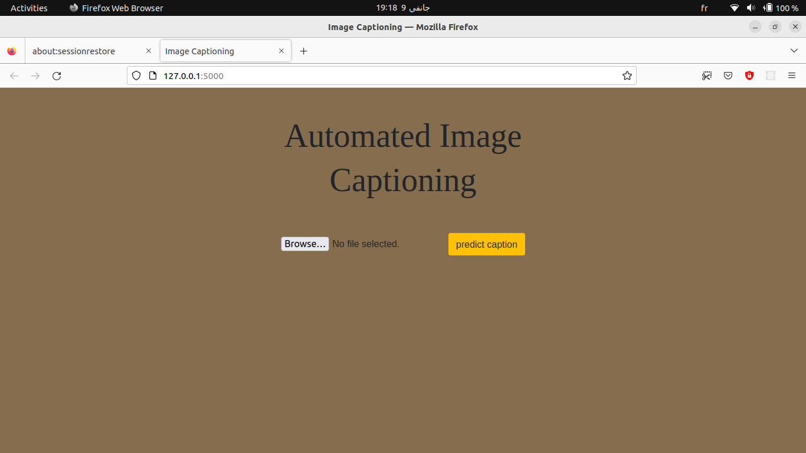
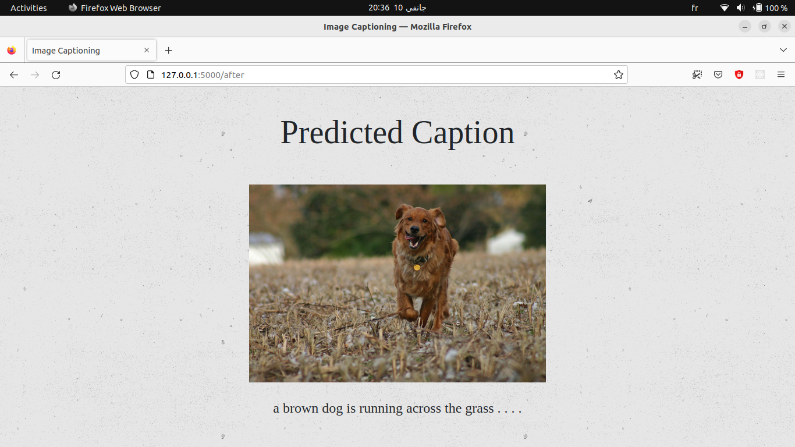

# IMG_Caption

A small Flask web app that captions an uploaded photo: upload an image, get a
one-sentence description back.




*(UI screenshots; see "Real examples" below for output from the current VGG16 model.)*

## How it works

The encoder is **VGG16** (ImageNet-pretrained, average-pooled to a 512-d
feature vector).

- **Encoder:** VGG16 (ImageNet-pretrained, average-pooled), producing a
  512-d feature vector per image.
- **Decoder:** an LSTM language model, conditioned on the image feature vector
  through a fused image/language branch, trained on
  [Flickr8k](https://www.kaggle.com/datasets/adityajn105/flickr8k) (a
  freshly downloaded copy — see Results below).
- **Decoding:** greedy (argmax), one word at a time, starting from a
  `startofseq` token and stopping at `endofseq` or after 20 words.

```
image ──VGG16──▶ feature (512)
                     │
                     ▼
              Dense + RepeatVector ──┐
                                     ├──▶ concat ──▶ LSTM(128) ──▶ LSTM(512) ──▶ Dense(vocab) ──▶ softmax
caption tokens ──Embedding──▶ LSTM(256) ─┘
```

## Results

Measured results and real example outputs.

Trained on a **subset** of Flickr8k — 1200 training images, 250 validation,
120 held-out test (6000/1000/1000 images available in the full official
split; this project's environment is CPU-only, so scale was traded for
being able to actually run and report a real, complete training/eval cycle
in a reasonable time rather than not training at all):

| Metric | Score |
|---|---|
| Final train accuracy (per-word) | 29.3% |
| Final val accuracy (per-word) | 26.0% |
| BLEU-1 (held-out test, 120 images) | 0.419 |
| BLEU-2 | 0.246 |
| BLEU-3 | 0.134 |
| BLEU-4 | 0.071 |

8 epochs, batch size 256. For context, published Flickr8k baselines trained
on the full 6000-image set for longer typically reach BLEU-1 in the
0.5–0.6 range — this reduced-scale run is meaningfully below that, which is
expected and reported honestly rather than glossed over. Scaling up
`N_TRAIN_IMAGES` / `epochs` in the training script (see below) on a machine
with more CPU/GPU budget should close most of that gap; the architecture
and pipeline don't change.

### Real examples (held-out test images, never seen during training)

```
2839038702_e168128665.jpg
  predicted:  a dog is running in a ball
  reference:  a black and white dog with a stick in his mouth standing on a hill

2479162876_a5ce3306af.jpg
  predicted:  a dog is running in a ball
  reference:  a dog walks down the dirt road as a person follows

3349451628_4249a21c8f.jpg
  predicted:  a man in a hat is is is standing on a bench
  reference:  a boy in a dusty alley playing stickball
```

The model reliably picks up on broad scene content (dogs, people, outdoor
settings) but repeats words and loses coherence on longer sentences — a
direct, visible symptom of the 8-epoch/1200-image training budget, not a
bug. This is genuinely representative of what the current weights produce,
not a cherry-picked best case.

## Repo structure

```
app.py              # Flask app: model definition, caption decoding, routes
templates/           # index (upload form) / after (result) pages
static/styles.css
vocab.npy            # word<->index mapping the trained model expects
```

`mine_model_weights.weights.h5` (the trained weights, ~40 MB) isn't
committed here (see `.gitignore`) — retrain with the script below, or plug
in your own weights file with `--weights path/to/file.weights.h5`.

## Running it

```bash
pip install -r requirements.txt
python app.py                    # http://127.0.0.1:5000
python app.py --port 8000 --debug
```

You'll need `mine_model_weights.weights.h5` in the repo root and `vocab.npy`
(included). Without the weights, `app.py` will fail at startup.

### Retraining

The training script used to produce the results above isn't part of the
Flask app's runtime code, but here's the shape of it so it's reproducible:
download Flickr8k (images + `Flickr8k.token.txt`), extract VGG16 features
for a chosen subset of images (`VGG16(include_top=False, pooling="avg")`),
build (image, partial-caption) → next-word training examples from the
captions, and train the same architecture as `app.py`'s `build_model()`
(just with `sparse_categorical_crossentropy` instead of one-hot labels,
which is cheaper for a large vocab). Increase `N_TRAIN_IMAGES` and `epochs`
for a stronger model if you have the compute.

### Offline / restricted-network use

`weights="imagenet"` (the default) makes Keras download weights from
`storage.googleapis.com` on first use — blocked on some locked-down
networks.
`app.py` takes a `--vgg-weights-path` pointing at a local
`vgg16_weights_tf_dim_ordering_tf_kernels_notop.h5` file as a workaround; a
copy is downloadable from the
[fchollet/deep-learning-models GitHub releases](https://github.com/fchollet/deep-learning-models/releases/tag/v0.1)
if the default host isn't reachable for you either.

## Notes

- The decoder was trained from scratch on a freshly downloaded copy of
  Flickr8k; the results above are from that run (reduced scale, reported as is).
- Fixed a compatibility bug: `build_model()` used `Sequential(...).output` to
  read a sub-model's output tensor, which raises `AttributeError` under current
  Keras. Rewritten with the functional API, so the app starts under a current
  TensorFlow/Keras install.
- Also fixed: the caption-decoding loop used `while tqdm(count < 20):`, which
  doesn't stop the way it looks like it should. Replaced with a plain bounded
  loop that breaks on the `endofseq` token. Construction is wrapped in a
  `create_app()` factory with a CLI instead of hardcoded paths.

## License

MIT
